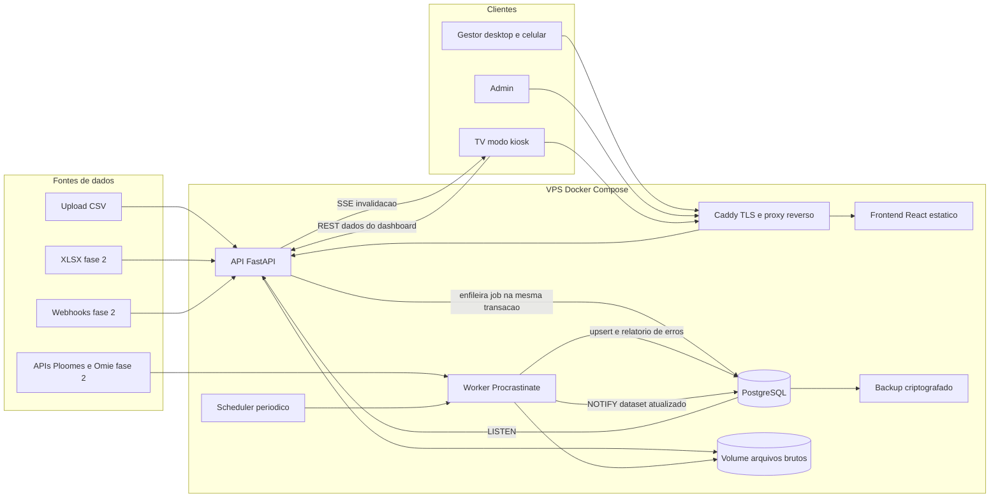
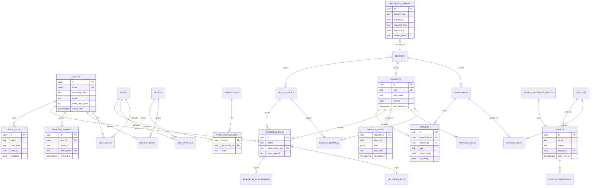
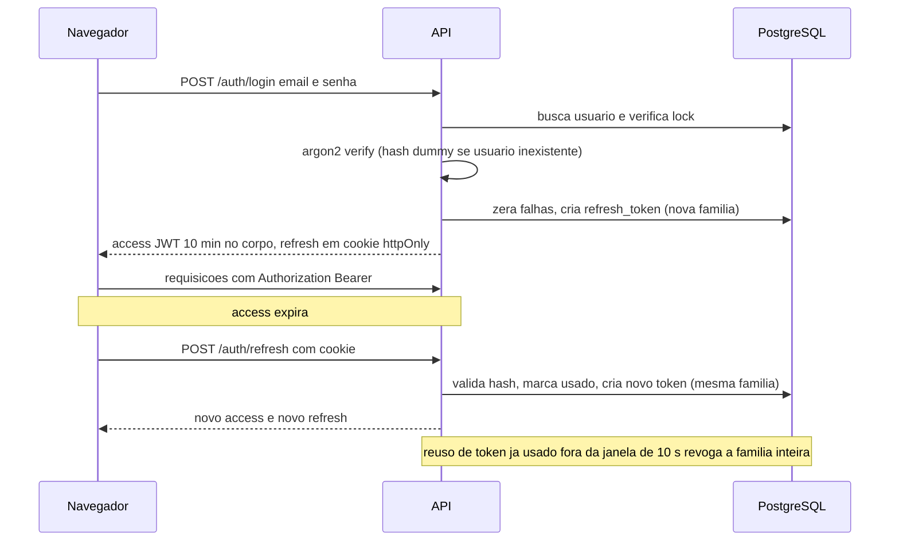
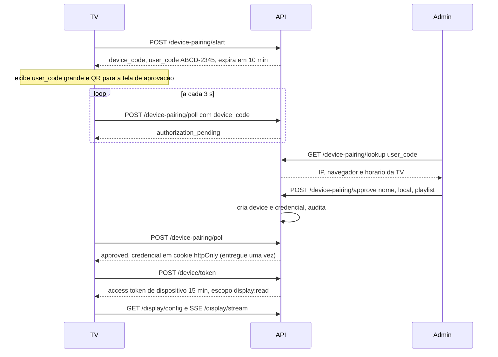

# Plano Técnico: Gamatermic Dash (MVP e Roadmap)

Projeto: gamatermic-dash | Versão: 1.0 | Data: 30/10/2026 | Estado: proposta para aprovação
Escopo desta etapa: ~~somente planejamento~~ **MVP (Fase 0 a E10) executado em 30/10/2026**. Ver `README.md`, `docs/adr/0000-desvios-do-plano.md` e os runbooks.

> **Estado da execução:** E1–E10 implementados e verificados (98 testes de backend, 17 de frontend, 6 E2E Playwright, ruff/mypy/import-linter/eslint/tsc limpos; pareamento→exibição→revogação validado em navegador real). **Pendentes que dependem de terceiros:** Spike B no hardware real da TV (24 h), validação das metas com a diretoria, tokens oficiais da marca, documentação oficial Ploomes/Omie (ADR 0008) e a VPS/domínio para o deploy (arquivos prontos; `docker compose` não foi executado por falta de daemon Docker na máquina de desenvolvimento).

Legenda: **[Fato]** veio do briefing; **[Proposta]** decisão recomendada; **[Hipótese]** a validar; **[A confirmar]** depende de leitura de documentação oficial (Ploomes/Omie) ou de dado real da empresa.

---

## 1. Perguntas em aberto e suposições adotadas

Perguntas que mudariam a arquitetura, cada uma com a suposição adotada para não bloquear o plano:

1. **O que significa "tempo real" nas TVs?**
   - Suposição: tempo quase real. Meta (SLO): do commit de uma carga até a TV atualizada em até 5 s (p95). Não há streaming nem CDC. Como a fonte inicial é CSV, a "frescura" real é limitada pela frequência dos uploads. A TV mostra sempre "dados de HH:MM" e "atualizado há X".
   - Impacto se mudar: se for necessário sub-segundo ou eventos contínuos, muda a ingestão (fila de eventos), não a camada de exibição.
2. **Qual o hardware/navegador das TVs?**
   - Suposição: mini-PC, Android TV box ou Chromecast com Google TV rodando Chromium/Chrome em kiosk, em 1920x1080 ou 4K. Smart TVs nativas com navegador antigo ficam fora do suportado inicialmente.
   - Validação: spike na Fase 0 no equipamento real. Define o target de build (ES2020+) e se SSE/Service Worker funcionam.
3. **Layout e semântica dos CSVs (e XLSX)?**
   - Suposição: exportações do Ploomes/Omie ou planilhas internas, em UTF-8 ou Latin-1 (Excel BR), separador `;` ou `,`, decimal com vírgula, data `dd/mm/aaaa`. O parser trata isso por configuração por fonte.
   - Suposição de carga: cada dataset declara um modo: `upsert` por chave natural (padrão), `append` ou `replace_snapshot` (o arquivo é o estado completo; o que sumiu é removido). Chave natural declarada pelo admin (ex.: número do pedido, número do contrato).
   - Pendência: obter 2 a 3 arquivos reais (vendas, contratos, metas) antes de congelar os datasets iniciais.
4. **Quais KPIs exatos de "Vendas e contratos"?**
   - Suposição (a validar com a diretoria): ver seção 10, Fase 1, dashboards `Vendas - Visão Geral` e `Contratos - Carteira e Vencimentos`. Datasets: `vendas_pedidos`, `contratos`, `metas_vendas`.
5. **APIs Ploomes e Omie.**
   - Suposição: não estudadas; ficam para a Fase 2 depois de um spike. O MVP entrega o framework de conectores e prova o contrato de plugin com o conector CSV. [A confirmar] em documentação oficial: autenticação, paginação, limites de requisição e disponibilidade de webhooks de cada uma.
   - Desvio consciente do exemplo do enunciado ("1 CSV + 1 API"): recomendo não colocar API real no MVP; se o spike da Fase 0 mostrar API simples, antecipar.
6. **Volume e escala.**
   - Suposição: até ~1 milhão de linhas por dataset, até ~20 TVs simultâneas, até ~50 usuários, 1 VPS (2 a 4 vCPU, 4 a 8 GB). Um único tenant. Metas de desempenho são hipóteses até o baseline da Fase 0.
7. **Identidade.** Suposição: login local e-mail+senha no MVP. SSO (Google Workspace/Microsoft 365) e MFA entram na Fase 2. [A confirmar] qual suite a empresa usa.
8. **E-mail (SMTP).** Suposição: indisponível no MVP; reset de senha é feito por admin (senha temporária com troca obrigatória). Reset por e-mail na Fase 2.
9. **Dados pessoais nos arquivos de venda.** Suposição: ingerir apenas campos de negócio (cliente PJ, valor, marca, vendedor). CPF/dados de pessoa física não devem ser carregados; campos sensíveis podem ser marcados como `pii` no dataset e mascarados.
10. **Idioma/fuso.** pt-BR, `America/Sao_Paulo` na exibição, UTC no armazenamento.
11. **Backup/retenção.** Suposição: RPO de 24 h e RTO de 4 h; backup diário criptografado para armazenamento externo.

Fora de escopo do MVP (proposta): SSO, MFA, reset de senha por e-mail, conectores reais Ploomes/Omie, webhooks de entrada, XLSX, rascunho/versionamento de dashboards, pré-agregação (rollups), alertas (WhatsApp/e-mail), exportação PDF/PNG, campos calculados, segurança por linha (RLS por valor de dado), multi-tenant, app nativo, edição colaborativa em tempo real, SQL livre pelo usuário.

---

## 2. Visão de arquitetura

### 2.1 Diagrama



### 2.2 Componentes

- **Caddy**: TLS automático (Let's Encrypt), proxy reverso, mesmo origem para web e API (`/` e `/api`), `flush_interval -1` para não bufferizar SSE, headers de segurança. Mesma origem reduz superfície de CORS.
- **Frontend React+TS (build estático)**: três "shells" sobre a mesma base: App de gestão (desktop/mobile), Painel Admin e Player TV (rota `/tv`).
- **API FastAPI** (uvicorn, 2 workers): REST `/api/v1`, SSE, auth, autorização, query engine.
- **Worker (Procrastinate)**: executa ingestões, pulls agendados, limpeza de tokens/arquivos, cálculo de frescor. Mesma base de código do backend.
- **PostgreSQL 16/17**: dados de aplicação, dados analíticos (JSONB), fila de jobs, auditoria, NOTIFY/LISTEN. Um único datastore na VPS.
- **Volume de arquivos**: uploads brutos (retenção configurável) para reprocessamento e auditoria. Evolução: S3 compatível (MinIO/Backblaze).
- **Observabilidade MVP**: logs JSON, Prometheus `/metrics` (rede interna), Sentry, Uptime Kuma. Grafana+Loki na Fase 2.

### 2.3 Justificativa das principais decisões

- **Monólito modular (API+worker, mesmo repo e mesmo código)**: equipe pequena, VPS única, domínio coeso. Microserviços aumentariam custo operacional sem ganho. Módulos por domínio com fronteiras claras permitem extrair depois.
- **Fila em PostgreSQL (Procrastinate)** em vez de Redis+Celery/ARQ: ver decisão em 12. Principal motivo: enfileiramento transacional (a linha `ingestion_runs` e o job nascem juntos ou nenhum nasce) e zero infraestrutura extra.
- **TVs via SSE como sinal de invalidação + REST para dados**: SSE é unidirecional, passa por proxy HTTP, reconecta sozinho e é mais simples que WebSocket. O payload SSE é mínimo (`dataset_id`, `version`); os dados vêm por REST autenticado e cacheável. Polling com ETag é o fallback.
- **Armazenamento analítico híbrido**: ver seção 4.2.
- **Autorização central em serviço de política**, aplicada no backend (dependência por rota + filtro nas consultas). Frontend só esconde UI.

---

## 3. Estrutura de pastas

Monorepo. Backend organizado **por domínio**, com as camadas pedidas dentro de cada domínio (routers → services → repositories → models). Justificativa: coesão por feature, evita pastas globais gigantes `routers/`, `services/`; a regra de dependência (router só chama service; service só chama repository/outros services; repository só toca models/DB) é imposta por lint (import-linter).

```
gamatermic-dash/
├─ docker-compose.yml              # dev; docker-compose.prod.yml; perfis opcionais (monitoring)
├─ Caddyfile
├─ .env.example                    # sem segredos reais
├─ .github/workflows/              # ci.yml, security.yml, deploy.yml
├─ docs/                           # ADRs, runbooks, diagramas, contratos de CSV
├─ backend/
│  ├─ pyproject.toml               # uv; ruff; mypy; pytest; import-linter
│  ├─ alembic.ini
│  ├─ alembic/                     # env.py async; versions/
│  ├─ app/
│  │  ├─ main.py                   # create_app, middlewares, routers, lifespan
│  │  ├─ core/
│  │  │  ├─ config.py              # pydantic-settings (env)
│  │  │  ├─ db.py                  # engine async, sessionmaker, base
│  │  │  ├─ security.py            # argon2, JWT, hashing de tokens
│  │  │  ├─ deps.py                # get_session, get_principal, require_permission
│  │  │  ├─ authz/                 # policy service, catálogo de permissões, cache
│  │  │  ├─ errors.py              # exceções de domínio + handlers problem+json
│  │  │  ├─ logging.py             # structlog, request_id
│  │  │  ├─ pagination.py, crypto.py (cifra de segredos), rate_limit.py
│  │  ├─ modules/
│  │  │  ├─ auth/                  # router, service, repository, models, schemas
│  │  │  ├─ iam/                   # users, roles, permissions, groups, grants, sectors
│  │  │  ├─ devices/               # pareamento, credenciais, playlists
│  │  │  ├─ datasources/           # fontes + bindings + registry de conectores
│  │  │  ├─ ingestion/             # runs, uploads, errors; pipeline/ (extract, transform, validate, load)
│  │  │  ├─ connectors/            # base.py (protocolo), csv_upload.py, http_pull.py (f2), ploomes.py, omie.py (f2)
│  │  │  ├─ datasets/              # datasets, fields, rows, freshness
│  │  │  ├─ query/                 # QuerySpec, compilador SQL, cache, guardas
│  │  │  ├─ dashboards/            # dashboards, widgets, widget types
│  │  │  ├─ display/               # endpoints do player TV, SSE, heartbeat
│  │  │  ├─ audit/
│  │  │  └─ health/
│  │  ├─ workers/
│  │  │  ├─ app.py                 # app Procrastinate
│  │  │  └─ tasks/                 # run_ingestion, scheduled_pull, purge_*, check_freshness
│  │  └─ container.py              # composição de services fora do FastAPI (worker/CLI)
│  └─ tests/ (unit/, integration/, contract/, e2e_api/)
└─ frontend/
   ├─ package.json                 # Vite, React, TS strict
   ├─ src/
   │  ├─ app/                      # providers, router, query client, error boundary, tema
   │  ├─ shared/
   │  │  ├─ api/                    # cliente gerado do OpenAPI (openapi-typescript + openapi-fetch)
   │  │  ├─ ui/                     # design system (shadcn/ui + Tailwind), tokens de tema (normal e TV)
   │  │  ├─ hooks/, lib/ (formatters pt-BR), types/
   │  ├─ features/
   │  │  ├─ auth/                   # login, sessão, guardas de rota
   │  │  ├─ dashboards/             # lista, visualização responsiva, filtros, drill-down
   │  │  ├─ dashboard-editor/       # grid editável, painel de config de widget
   │  │  ├─ widgets/                # registry: line, bar, pie, kpi, table, gauge (renderer + config schema)
   │  │  ├─ datasets/               # catálogo, campos, preview
   │  │  ├─ ingestion/              # upload, histórico de cargas, relatório de erros
   │  │  ├─ datasources/
   │  │  ├─ tv-player/              # pareamento, playlist, SSE, estado stale, rotação
   │  │  ├─ admin-users/ admin-roles/ admin-groups/ admin-grants/ admin-devices/ admin-playlists/
   │  │  └─ audit/
   │  └─ pages/                     # composição de rotas finas
   └─ e2e/                          # Playwright
```

Convenções: cada feature expõe só seu `index.ts` (API pública); `features/*` não importam umas das outras exceto via `shared`/registry; tipos de API vêm do OpenAPI gerado (fonte única de verdade do contrato).

Stack frontend [Proposta]: Vite + React 18/19 + TS strict, React Router, TanStack Query, Zustand (estado local leve do player/editor), react-hook-form + zod, Tailwind + shadcn/ui (Radix, acessível), ECharts, react-grid-layout (somente no editor).

Stack backend [Proposta]: Python 3.12, FastAPI, SQLAlchemy 2.x async + asyncpg, Alembic (env async), Pydantic v2, argon2-cffi, PyJWT, structlog, Procrastinate, uv. Cargas em massa por `INSERT ... ON CONFLICT` via SQLAlchemy Core/COPY (o ORM não é usado em carga em lote por desempenho; justificado). `expire_on_commit=False` e eager loading explícito (sem lazy load em async).

---

## 4. Modelo de dados

### 4.1 Entidades (resumo)

**Identidade e acesso**

- `users`: id, email (citext, único), full_name, password_hash (argon2id), status (`invited|active|locked|disabled`), failed_login_count, locked_until, must_change_password, last_login_at, password_changed_at, anonymized_at, timestamps.
- `roles` (is_system), `permissions` (catálogo em código, semeado), `role_permissions` (role_id, permission_id, **scope** `all|granted`).
- `groups` (ex.: "Comercial"), `user_roles`, `user_groups`, `group_roles`.
- `sectors` (ex.: "Vendas e Contratos"): dashboards e datasets pertencem a um setor. Permite separar dados por setor no futuro sem mudar o modelo.
- `resource_grants`: subject_type (`user|group|role`), subject_id, resource_type (`dashboard|dataset|sector`), resource_id, access_level (`view|edit|manage`), granted_by, expires_at opcional.
- `refresh_tokens`: id, user_id, family_id, parent_id, token_hash (SHA-256 do token opaco), issued_at, expires_at, used_at, revoked_at, revoked_reason, ip, user_agent.

**Dispositivos (TVs)**

- `device_pairing_requests`: id, device_code_hash, user_code (único enquanto pendente), status (`pending|approved|denied|expired|consumed`), expires_at, requested_ip, user_agent, approved_by, device_id.
- `devices`: id, name, location, status (`active|revoked`), playlist_id, last_seen_at, last_ip, user_agent, paired_by, paired_at, revoked_at, revoked_by.
- `device_credentials`: id, device_id, token_hash, issued_at, expires_at, revoked_at, last_used_at.
- `playlists` e `playlist_items` (playlist_id, dashboard_id, position, duration_seconds, transition). As dashboards autorizadas de um device = itens da playlist dele. Um único mecanismo de vínculo.

**Ingestão e dados**

- `data_sources`: id, name, kind (`csv_upload|http_pull|webhook|...`), config (JSONB validado por schema do conector), secret_encrypted (bytea, AES-GCM/Fernet com chave do ambiente), schedule_cron, is_enabled, sector_id, last_run_at.
- `datasets`: id, slug, name, sector_id, storage_kind (`jsonb|typed_table` futuro), load_mode (`upsert|append|replace_snapshot`), key_fields[], time_field, `version` (bigint, incrementa a cada carga com sucesso), row_count, last_loaded_at, freshness_sla_seconds.
- `dataset_fields`: dataset_id, name, label, data_type (`string|integer|decimal|date|datetime|boolean`), role (`dimension|measure|time`), nullable, is_key, is_indexed, sensitivity (`none|pii`), parse_options (JSONB: formato de data, separador decimal), position.
- `source_bindings`: data_source_id, dataset_id, field_mapping (coluna de origem → campo), parser_options (delimitador, encoding, linhas de cabeçalho), transform_config.
- `ingestion_runs`: id, data_source_id, dataset_id, trigger (`manual_upload|schedule|webhook|retry`), triggered_by, status (`queued|running|succeeded|succeeded_with_errors|failed|cancelled`), idempotency_key (único), file_id, started_at, finished_at, rows_read/inserted/updated/unchanged/rejected, error_summary, attempt, dataset_version_before/after, cursor_state.
- `uploaded_files`: id, original_name, stored_path (nome aleatório), size, sha256, detected_mime, detected_encoding, uploaded_by, purged_at.
- `ingestion_row_errors`: run_id, row_number, column_name, error_code, message, raw_excerpt (truncado, sem dados sensíveis completos).
- `webhook_events` (Fase 2): data_source_id, external_event_id (único por fonte), payload_hash, status, run_id.
- `dataset_rows`: dataset_id, row_key, data (JSONB), row_hash, occurred_at (valor do campo de tempo extraído), first_run_id, last_run_id, created_at, updated_at, deleted_at. PK (dataset_id, row_key).
- `dataset_rollups` (Fase 2): pré-agregados mantidos pelo worker.

**Dashboards**

- `dashboards`: id, slug, name, description, sector_id, grid_cols (12), refresh_interval_seconds, theme, status, `version` (lock otimista), created_by/updated_by, timestamps.
- `widgets`: id, dashboard_id, type, title, x, y, w, h, dataset_id, `query_config` (JSONB, validado por Pydantic via union discriminada), `viz_config` (JSONB: cores, formato, limiares, min/max/meta do gauge).
- `dashboard_versions` (Fase 2): snapshot JSONB para rascunho/publicação/rollback.

**Auditoria**

- `audit_logs`: id, occurred_at, actor_type (`user|device|system`), actor_id, action, resource_type, resource_id, outcome, ip, user_agent, request_id, metadata (JSONB com diff sem segredos). Particionada por mês.

### 4.2 Decisão: datasets flexíveis vs tabelas tipadas vs híbrido

Recomendação: **híbrido em camadas**.

- **Metadados tipados** (datasets, dataset_fields, bindings, runs): schema relacional forte; é o "contrato" do dado.
- **Armazenamento de linhas em tabela única com JSONB** (`dataset_rows`) mais metadados de schema. Motivo: novos setores/datasets sem DDL dinâmico nem deploy; migrations Alembic controlam só a estrutura da aplicação; validação e coerção de tipos acontecem na ingestão a partir de `dataset_fields`.
- **Consulta sempre por QuerySpec declarativo** compilado para SQLAlchemy Core com cast conforme o tipo do campo. Nomes de campos nunca são interpolados: são resolvidos contra `dataset_fields` (lista branca).
- **Alavancas de desempenho**, em ordem: (1) índice `(dataset_id, occurred_at)` e índice parcial `WHERE deleted_at IS NULL`; (2) índices de expressão por campo `is_indexed` criados pelo worker; (3) cache de resultado por `(query_hash, dataset_version)` com single-flight (invalidação automática pela versão); (4) rollups por dia x dimensões declaradas (Fase 2); (5) **promoção** de um dataset a tabela tipada (`storage_kind=typed_table`) na Fase 3 se p95 > 300 ms medido em carga real. A interface `QueryExecutor` isola essa troca.
- Por que não só tabelas tipadas por domínio: cada novo dataset exigiria migration+deploy e o sistema deixaria de ser configurável pelo admin. Por que não só JSONB cru: sem metadados não há validação, tipagem, UI de configuração de widget nem controle de campos sensíveis.
- Views materializadas puras não são recomendadas para datasets dinâmicos (DDL por dataset, refresh custoso); preferir rollups incrementais mantidos pelo worker.
- Precisão: valores monetários como `decimal` (numeric do JSONB); a API serializa decimais como string e o frontend formata com `Intl` pt-BR/BRL.

### 4.3 Diagrama ER



### 4.4 Modelo de autorização (RBAC + concessão por recurso)

Duas camadas avaliadas em conjunto:

1. **Permissão global (RBAC)**: o usuário precisa ter a permissão via roles (diretas ou herdadas de grupos). Catálogo inicial: `dashboard:view`, `dashboard:create`, `dashboard:edit`, `dashboard:delete`, `dataset:view`, `dataset:manage`, `dataset:query`, `datasource:manage`, `ingestion:upload`, `ingestion:view`, `playlist:manage`, `device:manage`, `user:manage`, `role:manage`, `group:manage`, `grant:manage`, `audit:view`.
2. **Escopo por recurso**: cada `role_permissions.scope` é `all` (vale para todos os recursos do tipo) ou `granted` (só recursos com concessão em `resource_grants`, direta, por grupo, por role ou herdada do setor). Ex.: role "Gestor de Vendas" tem `dashboard:view` com scope `granted` e uma concessão no setor "Vendas e Contratos".

- Regra de decisão: permitido se (tem a permissão com scope `all`) OU (tem a permissão com scope `granted` E existe concessão com access_level suficiente no recurso ou no setor dele).
- **Acesso a dados via dashboard**: quem vê uma dashboard consome os dados dos widgets dela sem precisar de concessão no dataset (consulta é a definida no widget). Consulta ad hoc (editor) exige `dataset:query` e acesso ao dataset.
- Roles de sistema semeadas (perfis): `Administrador` (tudo, scope all), `Editor de Dashboards`, `Operador de Dados` (upload e histórico), `Gestor` (view granted), `Visualizador`. Roles customizadas via painel.
- Guardas: não é possível remover o último Administrador; ninguém atribui role/permissão que exceda as próprias (anti escalonamento), exceto Administrador; mudanças incrementam `authz_version` do usuário, invalidando o cache.
- **Dispositivos** não passam por RBAC de usuário: principal `device` com escopo fixo `display:read` e acesso somente às dashboards da playlist.

---

## 5. Endpoints da API

Base `/api/v1`. Erros em `application/problem+json` (RFC 9457). Listagens com paginação por cursor. OpenAPI é a fonte do contrato (cliente TS gerado). "Pública" = sem token. Toda rota não pública exige dependência de segurança; teste automatizado falha se uma rota não declarar política.

**Auth**

- POST `/auth/login`: pública, rate limit; retorna access token e define cookie de refresh.
- POST `/auth/refresh`: cookie de refresh; rotaciona.
- POST `/auth/logout`: autenticado; revoga a família do refresh atual.
- POST `/auth/logout-all`: autenticado; revoga todas as sessões.
- GET `/auth/me`: autenticado; perfil, roles e permissões efetivas.
- POST `/auth/change-password`: autenticado; exige senha atual; revoga demais sessões.
- (Fase 2) POST `/auth/password-reset/request` e `/confirm`; MFA TOTP.

**Usuários, roles, grupos, concessões, setores**

- GET/POST `/users`: `user:manage`.
- GET/PATCH `/users/{id}`: `user:manage`. DELETE `/users/{id}`: desativa (soft). POST `/users/{id}/unlock`, POST `/users/{id}/reset-password` (senha temporária): `user:manage`.
- PUT `/users/{id}/roles`, PUT `/users/{id}/groups`: `user:manage` (com guarda anti escalonamento).
- GET `/users/{id}/effective-permissions`: `user:manage` (explica por que alguém pode ou não ver algo).
- POST `/users/{id}/anonymize`: `user:manage` (LGPD). GET `/me/export`: autenticado (dados do próprio titular).
- GET `/permissions`: `role:manage` (catálogo somente leitura).
- GET/POST `/roles`, GET/PATCH/DELETE `/roles/{id}`, PUT `/roles/{id}/permissions`: `role:manage`.
- GET/POST `/groups`, PATCH/DELETE `/groups/{id}`, PUT `/groups/{id}/members`, PUT `/groups/{id}/roles`: `group:manage`.
- GET `/resources/{type}/{id}/grants`, PUT `/resources/{type}/{id}/grants` (substitui o conjunto): `grant:manage` + `manage` no recurso.
- GET/POST/PATCH `/sectors`: `user:manage`/`dataset:manage`.

**Dispositivos e playlists**

- POST `/device-pairing/start`: pública, rate limit; devolve `device_code`, `user_code`, `expires_in`, `interval`.
- POST `/device-pairing/poll`: pública por `device_code`; estados `authorization_pending|slow_down|expired|denied|approved`; na aprovação entrega a credencial uma única vez (cookie httpOnly).
- GET `/device-pairing/lookup?user_code=`: `device:manage`; mostra metadados da TV solicitante.
- POST `/device-pairing/approve`, POST `/device-pairing/deny`: `device:manage`.
- POST `/device/token`: credencial de dispositivo; troca por access token curto do dispositivo.
- GET `/devices`, GET/PATCH `/devices/{id}`: `device:manage`. POST `/devices/{id}/revoke`: `device:manage`. PUT `/devices/{id}/playlist`: `device:manage`.
- GET/POST `/playlists`, PATCH/DELETE `/playlists/{id}`, PUT `/playlists/{id}/items`: `playlist:manage` (e `view` nas dashboards incluídas).

**Display (principal device ou usuário em modo preview)**

- GET `/display/config`: playlist do dispositivo, intervalo de heartbeat, versão do frontend esperada.
- GET `/display/dashboards/{id}`: definição da dashboard (somente se na playlist).
- GET `/display/dashboards/{id}/data`: dados de todos os widgets em lote com ETag; 304 quando nada mudou.
- GET `/display/stream`: SSE (eventos `dataset_updated`, `config_changed`, `revoked`, comentário de heartbeat).
- POST `/display/heartbeat`: atualiza `last_seen_at`, versão do app, estado stale.

**Fontes, datasets, ingestão**

- GET/POST `/data-sources`, GET/PATCH/DELETE `/data-sources/{id}`: `datasource:manage`. POST `/data-sources/{id}/test`, POST `/data-sources/{id}/run` (pull manual), PUT `/data-sources/{id}/binding`: `datasource:manage`.
- POST `/webhooks/{source_id}` (Fase 2): pública com assinatura HMAC + timestamp.
- GET/POST `/datasets`, GET/PATCH/DELETE `/datasets/{id}`: `dataset:view` / `dataset:manage` (+ grant).
- PUT `/datasets/{id}/fields`: `dataset:manage`. POST `/datasets/infer-schema` (a partir de amostra do arquivo): `dataset:manage`.
- GET `/datasets/{id}/preview`: `dataset:view` (campos `pii` mascarados sem permissão específica).
- POST `/datasets/{id}/uploads` (multipart, header opcional `Idempotency-Key`): `ingestion:upload` + grant; responde `202` com `run_id`.
- GET `/ingestion/runs` (filtros origem, status, dataset, período), GET `/ingestion/runs/{id}`: `ingestion:view`.
- GET `/ingestion/runs/{id}/errors` (paginado) e `/errors.csv` (relatório; células neutralizadas contra CSV injection): `ingestion:view`.
- POST `/ingestion/runs/{id}/cancel`, POST `/ingestion/runs/{id}/retry`: `ingestion:upload`.
- GET `/ingestion/runs/{id}/events`: SSE de progresso (alternativa: polling).

**Query e dashboards**

- POST `/query/preview`: `dataset:query` + acesso ao dataset (usado pelo editor; limites rígidos).
- GET `/widget-types`: autenticado (catálogo e JSON Schema de config).
- GET `/dashboards` (somente as acessíveis), POST `/dashboards`: `dashboard:view` / `dashboard:create`.
- GET `/dashboards/{id}`: `dashboard:view` + acesso. PATCH/DELETE: `dashboard:edit`/`dashboard:delete` (lock otimista via `version`/`If-Match`).
- PUT `/dashboards/{id}/layout`: `dashboard:edit`. POST `/dashboards/{id}/widgets`, PATCH/DELETE `/dashboards/{id}/widgets/{wid}`: `dashboard:edit`. POST `/dashboards/{id}/duplicate`: `dashboard:create`.
- POST `/dashboards/{id}/data`: `dashboard:view`; lote de widgets com filtros/período interativos (override restrito pela configuração do widget).

**Auditoria e operação**

- GET `/audit-logs`, GET `/audit-logs/export`: `audit:view`.
- GET `/health/live`, `/health/ready`: internos; GET `/metrics`: rede interna.

Contrato do **QuerySpec** (proposto): `measures[{field, agg(sum|avg|count|min|max|count_distinct), alias}]`, `dimensions[field]`, `time{field, granularity(day|week|month|quarter|year)}`, `filters[{field, op(eq|neq|in|gt|gte|lt|lte|between|contains), value}]`, `sort`, `limit` (máx. 5.000), `period{mode(relative|absolute), preset(today|this_month|last_30_days|this_year|...), from, to}`, `compare_previous_period(bool)`. Não existe SQL livre.

---

## 6. Fluxos detalhados

### 6.1 Login e refresh



Passos e regras:

1. Login: rate limit por IP (ex.: 10/min) e por conta; mensagem genérica; resposta de tempo similar para usuário inexistente (hash dummy); 5 falhas consecutivas bloqueiam 15 min (progressivo); evento de auditoria em sucesso e falha.
2. Access token JWT (10 a 15 min): claims `sub`, `sid`, `jti`, `iss`, `aud`, `iat`, `exp`, `typ=user`; algoritmo fixo na validação (HS256 com segredo forte e `kid` para rotação; migrar para EdDSA se outro serviço precisar verificar). Permissões **não** vão no token: são resolvidas no servidor por requisição com cache curto (TTL 60 s + invalidação por `authz_version`).
3. Refresh token: aleatório opaco de 256 bits, guardado só como hash; cookie `httpOnly; Secure; SameSite=Strict; Path=/api/v1/auth`; access token apenas em memória no frontend (nunca localStorage). Proteção CSRF no refresh: SameSite + verificação de `Origin` + header customizado.
4. Rotação a cada uso; janela de tolerância de 10 s para abas concorrentes (devolve o mesmo sucessor); reuso fora da janela revoga a família (indício de roubo) e audita. Vida: idle 7 dias, absoluta 30 dias.
5. Logout revoga a família; troca de senha, desativação do usuário e `logout-all` revogam todas.
6. Política de senha (NIST 800-63B): mínimo 12 caracteres, sem regras de composição forçadas, bloqueio de senhas comuns/vazadas (lista local; HIBP k-anonymity opcional), argon2id (parâmetros calibrados no hardware da VPS, mínimo OWASP), pepper opcional em segredo do ambiente.

### 6.2 Pareamento de TV



Regras:

- Inspirado no OAuth Device Authorization Grant (RFC 8628). `device_code` de 256 bits (só o hash é guardado) para polling; `user_code` de 8 caracteres de alfabeto sem ambiguidade (sem 0/O/1/I), validade 10 min, limite de tentativas por código e por sessão admin, uso único.
- Aprovação exige `device:manage` e o aprovador só pode atribuir playlist cujas dashboards ele próprio pode ver. Mostrar IP/UA da TV para o admin confirmar que é a TV correta (anti phishing de código).
- Credencial do dispositivo: opaca de 256 bits, hash no banco, validade 12 meses com renovação deslizante, entregue em cookie `httpOnly; Secure; SameSite=Strict; Path=/api/v1/device` (fallback localStorage só se o navegador da TV bloquear cookies). É trocada por JWT curto (`typ=device`, claims `device_id`, `scope=display:read`).
- Revogação: `POST /devices/{id}/revoke` invalida credencial, emite evento SSE `revoked`; a TV volta à tela de pareamento. Dispositivo nunca acessa rotas de usuário (dependência `require_user` rejeita `typ=device` e vice-versa). Acesso a dados somente via `/display/*` limitado às dashboards da playlist.
- Reaproveitar a TV em outro setor: trocar a playlist (sem repareamento).

### 6.3 Upload de CSV (assíncrono)

1. **Upload** (`POST /datasets/{id}/uploads`): valida permissão e grant; valida limites (tamanho, ex. 20 MB; tipo por extensão + magic bytes + MIME declarado; rejeita binários/macros); grava em streaming em volume fora do webroot com nome UUID; calcula sha256.
2. **Idempotência**: mesmo sha256 já carregado com sucesso para o mesmo dataset retorna a carga existente (ou exige confirmação explícita "reprocessar"). Header `Idempotency-Key` cobre reenvio do cliente.
3. Na **mesma transação**: cria `uploaded_files`, `ingestion_runs(queued)` e o job; responde `202` com `run_id` e URL de status.
4. **Worker**: detecta encoding (BOM/charset-normalizer) e delimitador conforme `parser_options`; lê em streaming em lotes (ex. 5.000 linhas).
5. **Validação do cabeçalho**: coluna obrigatória ausente → falha da carga inteira com mensagem clara; colunas extras → aviso (não erro).
6. **Por linha**: coerção de tipos pt-BR (decimal `1.234,56`, data `dd/mm/aaaa`, booleanos), obrigatórios, domínios; erro vira `ingestion_row_errors` (linha, coluna, código, mensagem, trecho). Normalização: trim, NFC, vazio→null.
7. **Limite de rejeição** configurável por dataset: se rejeitadas > X% (ex. 20%) ou modo estrito, a carga falha sem tocar nos dados vigentes.
8. **Carga**: linhas válidas vão a tabela de staging (UNLOGGED, por run) e são mescladas em **uma transação**: `INSERT ... ON CONFLICT (dataset_id,row_key) DO UPDATE ... WHERE row_hash distinto` (conta inseridas/atualizadas/inalteradas). Em `replace_snapshot`, remove (soft delete) linhas cuja `last_run_id` não é a atual. Sem chave declarada, só `append` com idempotência por arquivo.
9. **Commit**: incrementa `datasets.version`, atualiza `last_loaded_at`/`row_count`, status `succeeded` ou `succeeded_with_errors`, audita, dispara `NOTIFY dataset_updated`.
10. **Falhas do worker**: retry com backoff para erros transitórios; run presa em `running` além do timeout é marcada `failed` por rotina de verificação; reprocessamento seguro porque a carga é idempotente.
11. **Relatório**: tela de histórico mostra contadores e permite baixar CSV de erros (células iniciadas com `= + - @` neutralizadas).
12. **Segurança do arquivo**: tratamento de CSV injection: dados armazenados como texto e **sempre renderizados como texto** (nunca interpretados como fórmula); em qualquer exportação CSV/XLSX, prefixar com apóstrofo; XLSX (Fase 2) lido em modo somente leitura (openpyxl read_only/calamine), limite de tamanho descomprimido (anti zip bomb), macros rejeitadas.

### 6.4 Ingestão via API (Fase 2, contrato definido já no MVP)

Contrato do conector (Protocol): `kind`, `config_schema` (Pydantic), `test_connection()`, `fetch(ctx, cursor) -> AsyncIterator[RecordBatch]`, `supports_push`, `describe_schema()` opcional. Registro por decorator/entry point; o núcleo (pipeline Extract→Transform→Validate→Load) é o mesmo do CSV, só muda o `fetch`.

1. Scheduler (cron do Procrastinate) enfileira `scheduled_pull` conforme `schedule_cron` com `idempotency_key = source_id + janela`/cursor.
2. Worker carrega o conector, descriptografa o segredo em memória, executa `fetch` com timeout, paginação, respeito a rate limit da API (backoff, `Retry-After`) e **proteção SSRF** (bloqueio de IPs privados/metadata, sem seguir redirect para rede interna, allowlist de domínios).
3. Cursor/`updated_since` salvo em `ingestion_runs.cursor_state` para carga incremental; mapeamento via `source_bindings`.
4. Mesmo pipeline de validação, staging, merge e notificação do 6.3.
5. Webhook push: `POST /webhooks/{source_id}` valida HMAC + timestamp (anti replay), grava `webhook_events` com `external_event_id` único (idempotência), responde 202 e enfileira.
6. Ploomes e Omie: conectores dedicados implementados só após spike [A confirmar em documentação oficial]: autenticação, paginação, limites, campos de negócio e webhooks.

### 6.5 Renderização de dashboard

1. **Gestor (desktop/mobile)**: carrega `GET /dashboards/{id}` (layout e widgets) e `POST /dashboards/{id}/data` com período/filtros escolhidos. Grade 12 colunas; no mobile os widgets empilham por ordem (y, x). Drill-down: clique em barra/fatia aplica filtro e reconsulta; tabela permite detalhar linhas.
2. **TV**: `GET /display/config` → playlist; para cada item, `GET /display/dashboards/{id}` e `/data` (ETag). Layout em grade CSS fluida que preenche a tela (sem scroll), tipografia por `clamp()` e alto contraste (tema TV).
3. Servidor resolve cada widget: valida autorização da dashboard, monta QuerySpec a partir do widget (+ overrides permitidos), executa com `statement_timeout`, usa cache `(query_hash, dataset_version)`, devolve `{widget_id, data, dataset_version, data_as_of, generated_at}`.
4. Cliente registra renderer por tipo no `widgets` registry; config inválida de um widget exibe estado de erro isolado (não derruba a dashboard).

---

## 7. Atualização das TVs e desempenho

### 7.1 Estratégia de atualização

- **Camadas**: (1) SSE `dataset_updated {dataset_id, version}` → o player invalida só widgets ligados ao dataset, com debounce de 1 a 2 s, e refaz o lote; (2) fallback: polling a cada 60 s com `If-None-Match` (barato, 304); (3) cache local do último dado em memória/IndexedDB.
- **Heartbeat** de SSE a cada 25 s; sem sinal por 60 s o cliente considera conexão perdida e reconecta com backoff exponencial + jitter (1 s até 60 s).
- **Dois conceitos de "desatualizado"**, mostrados distintos: *conexão* (a TV não fala com o servidor há X min: badge "Sem conexão, dados de HH:MM") e *fonte* (o dataset passou do `freshness_sla`: badge "Dados de origem atrasados"). Em ambos, **mantém o último dado visível**, nunca limpa a tela.
- **Playlist**: rotação por `duration_seconds`, pré-carga da próxima dashboard, transição suave, pausa na rotação se houver erro, item removido/sem acesso é pulado.
- **Resiliência**: PWA/Service Worker para cachear o shell e iniciar sem rede; reload agendado diário (ex. 03:00) e reload automático quando `/display/config` informa nova versão do frontend (no limite de rotação); Wake Lock/flags de kiosk documentados no runbook da TV; deslocamento sutil de pixels contra burn-in (opcional).
- **Escala SSE**: 20 conexões são triviais para uvicorn; o listener LISTEN/NOTIFY é uma conexão dedicada do processo que distribui a assinantes locais. Com mais de uma réplica da API, usar Redis pub/sub (Fase 3).

### 7.2 Desempenho das consultas

- Guardas: `statement_timeout` de 5 s em role de leitura dedicada, `limit` máximo, limite de cardinalidade de agrupamento, campos validados por lista branca, sem joins livres.
- Índices: ver 4.2; BRIN opcional em `occurred_at` para datasets grandes e append-heavy.
- Cache + single-flight: após uma carga, N TVs pedem as mesmas consultas ao mesmo tempo; a primeira calcula, as demais reutilizam.
- Rollups (Fase 2): job pós-carga recalcula agregados por (dataset, dia, dimensões declaradas) em tabela própria; o compilador usa o rollup quando o QuerySpec é atendido por ele.
- **Metas (hipóteses a medir na Fase 0)**: widget p95 < 300 ms e dashboard completa < 1 s com 1 M de linhas, 8 widgets, em VPS de 2 vCPU/4 GB, método: dataset sintético + k6/pytest-benchmark. Sem baseline, as metas não são compromisso.

---

## 8. Segurança e auditoria

**OWASP Top 10 (mapeamento)**

- A01 Controle de acesso quebrado: política central, dependência obrigatória por rota, filtro de listagens no repositório (nunca "buscar e filtrar no router"), teste de matriz de permissões, teste que varre todas as rotas do OpenAPI.
- A02 Falhas criptográficas: TLS (HSTS), argon2id, segredos de conectores cifrados (AES-GCM com chave fora do banco), tokens guardados só como hash.
- A03 Injeção: queries parametrizadas; QuerySpec com lista branca; nenhum SQL livre; ORM/Core sem string concat; teste property-based (hypothesis) do compilador.
- A04 Design inseguro: modelagem de ameaças curta no ADR (pareamento, upload, token de TV).
- A05 Configuração incorreta: containers não-root, FS somente leitura quando possível, sem portas expostas além de 80/443/SSH, `DEBUG` off, docs OpenAPI protegidas em produção; **CORS restrito** ao(s) origem(ns) exata(s) (sem `*`, com credenciais só para a origem do app).
- A06 Componentes vulneráveis: `pip-audit`, `npm audit`, Trivy nas imagens, Dependabot, lockfiles.
- A07 Falhas de autenticação: rate limit no login (Caddy/slowapi + contadores no banco), lockout, refresh rotativo com detecção de reuso, MFA na Fase 2, política de senha.
- A08 Integridade: imagens com versão fixada, CI com checagem de lock, assinatura HMAC em webhooks, validação de artefatos de deploy.
- A09 Logs e monitoramento: auditoria + logs estruturados sem segredos/PII; alertas.
- A10 SSRF: conectores HTTP com allowlist, bloqueio de redes privadas e metadata, sem seguir redirects arbitrários.

**Outros controles**

- Headers: CSP estrita (sem inline), `X-Content-Type-Options`, `frame-ancestors 'none'`, `Referrer-Policy`, `Permissions-Policy`.
- Segredos: variáveis de ambiente/Docker secrets, `.env` fora do Git, rotação documentada (JWT `kid`, chave de cifra com re-encrypt).
- Banco com menor privilégio: roles distintas para migração, app/worker (DML) e leitura analítica (somente SELECT em `dataset_rows`); auditoria sem UPDATE/DELETE (trigger de bloqueio).
- Host: SSH apenas por chave, UFW, fail2ban, atualizações automáticas de segurança.
- Upload: lista na seção 6.3 (tamanho, tipo, magic bytes, encoding, CSV injection, nomes aleatórios, ClamAV opcional na Fase 2).
- Rate limits sugeridos: login 10/min/IP e 5 falhas/conta; pareamento `start` 5/min/IP; `lookup/approve` 10/min/admin; uploads 10/min/usuário; webhooks por fonte.

**Auditoria** (`audit_logs`, append-only, gravado na mesma transação da ação quando ela altera estado)

- Eventos: `auth.login.success/failed/locked`, `auth.refresh.reuse_detected`, `auth.password.changed`, `user.create/update/disable/anonymize`, `role.create/update/delete`, `role.permissions.changed`, `group.*`, `grant.create/delete`, `device.pair.requested/approved/denied`, `device.revoked`, `playlist.updated`, `datasource.create/update`, `ingestion.upload/run.finished/cancel`, `dataset.update`, `dashboard.create/update/delete/layout.changed`, `audit.export`.
- Campos: quem (user/device/system), o quê, em qual recurso, resultado, IP, UA, `request_id`, diff antes/depois sem segredos.
- Particionamento mensal, retenção definida (sugestão 24 meses; ver LGPD), imutabilidade por permissões do banco e trigger; verificação por hash encadeado opcional na Fase 3.

**LGPD**

- Dados de usuário: nome, e-mail, papéis, IP/UA em logs. Base legal a registrar (execução de contrato de trabalho/legítimo interesse), minimização (sem CPF/telefone no cadastro), finalidade documentada, encarregado (DPO) identificado.
- Direitos do titular: exportação (`/me/export`), correção, anonimização na saída do colaborador (PII removida; `user_id` permanece pseudonimizado nos logs de auditoria, que têm base de segurança).
- Retenção: refresh tokens expirados e arquivos brutos purgados por job (sugestão 90 dias para arquivos, 24 meses para auditoria); IP em logs com prazo definido.
- Dados de clientes nos CSVs: marcar campos `pii`, mascarar em tabelas/preview para quem não tem permissão, recomendar não carregar dados de pessoa física; avaliar RIPD se houver.
- Backups criptografados, acesso restrito, plano de resposta a incidentes (notificação à ANPD/titulares em prazo razoável).

---

## 9. Testes e observabilidade

**Backend**

- Unitário (pytest, pytest-asyncio): services com repositórios fake; parser/validador de CSV com arquivos de referência (BOM, Latin-1, `;`, decimal pt-BR, datas inválidas, linhas rejeitadas, CSV injection); compilador de QuerySpec (inclusive property-based para injeção); política de autorização (matriz roles x scopes x grants).
- Integração: Postgres real via testcontainers (não SQLite); repositórios, upsert/idempotência, `replace_snapshot`, rotação/reuso de refresh, pareamento, LISTEN/NOTIFY; **migrações**: `upgrade head`, `downgrade`, e verificação de drift do autogenerate no CI.
- Contrato: snapshot do OpenAPI (mudança quebra o build se não aprovada) e fuzz com Schemathesis; teste que percorre todas as rotas e exige política de segurança declarada.
- Carga: k6 com 30 TVs (SSE + polling) e consultas em dataset de 1 M linhas.

**Frontend**

- Vitest + Testing Library + MSW (hooks, formulários, registry de widgets); testes de acessibilidade (axe).

**E2E (Playwright)**

- Login/refresh/logout; admin cria role e concessão e usuário vê só a dashboard permitida (e recebe 403 direto na API); upload de CSV com erros → relatório → dashboard atualizada na TV; pareamento com dois contextos de navegador (TV e admin); revogação faz a TV voltar ao pareamento; `context.setOffline` → badge "desatualizado" mantendo último dado; viewport mobile; snapshot visual da TV em 1920x1080.

**CI/CD**: ruff, mypy (strict nos módulos core), import-linter (camadas), ESLint, `tsc`, testes, `pip-audit`/`npm audit`/Trivy, build das imagens, deploy por SSH + `docker compose pull && up -d` com serviço `migrate` rodando antes da API. Meta pragmática: ≥ 85% de cobertura em services e política de autorização; sem meta cega no restante.

**Observabilidade**

- Logs JSON (structlog) com `request_id` propagado para o job (correlação API→worker); sem segredos/PII.
- Métricas Prometheus: latência/erros HTTP, `ingestion_runs_total{status}`, duração e linhas rejeitadas, profundidade da fila, conexões SSE, `devices_online`, `dataset_staleness_seconds`, `query_duration_seconds`, cache hit rate.
- Health: `/health/live` (processo) e `/health/ready` (DB e worker/queue).
- Alertas (Uptime Kuma/Alertmanager): carga falhou, dataset além do SLA, TV offline > N min, disco > 80%, backup falhou, taxa de 5xx.
- Runbooks: restauração de backup (testada trimestralmente), rotação de segredos, substituição de TV, carga travada.

---

## 10. Roadmap em fases

Estimativas só indicativas e condicionadas à capacidade da equipe (não conhecida). Premissa de referência: 1 a 2 desenvolvedores full-stack; a confirmar.

### Fase 0: Fundação e spikes (aprox. 1 a 2 semanas)

Objetivo: reduzir as maiores incertezas e deixar o esqueleto pronto.

- Repositório monorepo, Docker Compose dev/prod, CI (lint, testes, scans), Caddy, esqueleto FastAPI (camadas e import-linter), Alembic async, esqueleto React, cliente gerado do OpenAPI, migração baseline.
- **Spike A (desempenho)**: dataset sintético de 1 M linhas em JSONB + índices; medir QuerySpec típicos. Critério: baseline documentado; decisão de manter/ajustar.
- **Spike B (TV)**: página SSE+polling+Service Worker no hardware real da TV, via Caddy. Critério: reconecta após queda de rede, roda 24 h sem degradação.
- **Spike C (dados)**: obter CSVs reais (vendas, contratos, metas) e definir os contratos de dataset; ler documentação oficial Ploomes e Omie e registrar um ADR com limites e viabilidade.
- Saída: ADRs aprovados, baseline medido, datasets iniciais definidos.

### Fase 1: MVP (aprox. 8 a 10 semanas; revisar após a Fase 0)

Entrega de valor: setor Vendas e Contratos em TV e gestão, com RBAC completo e CSV.

**E1. Autenticação de usuários**

- Features: login, access curto + refresh rotativo com detecção de reuso, logout/logout-all, troca de senha, política de senha, lockout, rate limit, troca obrigatória no primeiro acesso.
- Aceite: 5 falhas bloqueiam a conta; refresh reutilizado revoga a família; senha fraca/comum é rejeitada; token de access expirado retorna 401 e o frontend renova sem perder a tela; segredos e tokens não aparecem em logs.

**E2. RBAC, grupos, concessões e painel admin**

- Features: catálogo de permissões, roles de sistema e customizadas, grupos, setores, concessões por recurso (usuário/grupo/role), CRUD admin de usuários/roles/grupos/concessões, tela "permissões efetivas", guardas anti escalonamento e do último admin.
- Aceite: usuário com role `Gestor` (view granted) vê só dashboards com concessão; acesso direto por ID a outra dashboard retorna 403/404 na API; admin muda permissão e o efeito ocorre em até 60 s; teste de varredura confirma que 100% das rotas têm política.

**E3. Auditoria**

- Features: `audit_logs` particionada, registro dos eventos da seção 8, tela de consulta com filtros e exportação.
- Aceite: login, mudança de permissão, upload, edição de dashboard, pareamento e revogação geram registro com ator, IP e `request_id`; registros não podem ser alterados pelo usuário do app.

**E4. Datasets e ingestão CSV**

- Features: CRUD de datasets e campos, inferência de schema por amostra, fonte `csv_upload` e binding, upload assíncrono, pipeline (validação, coerção pt-BR, staging, upsert idempotente, `replace_snapshot`), histórico de cargas, relatório de erros por linha (tela e CSV), reprocessar/cancelar, purga de arquivos, framework de conectores com contrato definido.
- Aceite: arquivo de 100 mil linhas processa sem bloquear a API (resposta 202 < 1 s); reenviar o mesmo arquivo não duplica linhas; arquivo com 3% de erros carrega as válidas e lista cada erro com linha/coluna; arquivo acima do limite ou com tipo inválido é recusado; células `=cmd` são exibidas como texto e neutralizadas no export; falha no meio da carga não altera os dados vigentes.

**E5. Query engine, dashboards e widgets**

- Features: QuerySpec + compilador seguro, cache por versão, widgets `kpi`, `line`, `bar`, `pie`, `table`, `gauge`, filtros e período configuráveis por widget, comparação com período anterior, persistência em banco, dashboards de partida `Vendas - Visão Geral` e `Contratos - Carteira e Vencimentos` (seed/semente editável).
- KPIs propostos [Hipótese a validar]: faturamento do mês vs meta (gauge), pedidos ganhos, ticket médio, vendas por marca (Parker, Danfoss, IMI, Alfa Laval, Spirax Sarco, Mecalor, Oilon), vendas por tipo (produto x serviço), evolução 12 meses, top vendedores/clientes, pipeline por etapa; contratos ativos, valor recorrente, contratos vencendo em 30/60/90 dias (KPI + tabela), contratos por tipo de serviço (NR-13, calibração, manutenção, montagem, eficiência energética).
- Aceite: mudar o período do widget altera o resultado sem deploy; consulta com campo inexistente retorna 422; widget p95 dentro da meta medida na Fase 0; um widget com erro não derruba a dashboard.

**E6. Editor de dashboards**

- Features: grade 12 colunas (react-grid-layout) com arrastar/redimensionar, galeria de widgets, painel de configuração (dataset, medidas, dimensões, filtros, período, formato), pré-visualização, duplicar, lock otimista.
- Aceite: layout salvo reaparece idêntico em desktop e TV; edição simultânea por dois usuários gera conflito 409 tratado na UI; apenas `dashboard:edit` com acesso enxerga o editor e o backend rejeita os demais.

**E7. Dispositivos, pareamento e playlists**

- Features: fluxo da seção 6.2, painel de dispositivos (online/offline, último acesso, revogar), playlists com duração por item.
- Aceite: TV nova exibe código e QR; admin aprova e a TV começa a exibir a playlist em até 10 s; código expira em 10 min e não pode ser reutilizado; revogar derruba a TV em até 30 s (evento SSE/poll); token de dispositivo recebe 403 em qualquer rota fora de `/display/*` e em dashboards fora da playlist.

**E8. Modo TV**

- Features: player em tela cheia, rotação, tema de alto contraste e tipografia grande, SSE+polling, estados stale (conexão e fonte), reload por versão, Service Worker, relógio e "dados de HH:MM".
- Aceite: carga concluída aparece na TV em até 5 s (p95) com SSE; derrubar a rede por 10 min mantém o último dado e mostra "desatualizado"; reconexão sem intervenção; 24 h contínuas sem crescimento anormal de memória; legível a 3 m em TV 1080p (checklist visual).

**E9. Experiência de gestão (desktop/mobile)**

- Features: lista de dashboards acessíveis, visualização responsiva (empilhada no mobile), filtros globais de período, drill-down por clique, modo "preview TV" para testar.
- Aceite: dashboards utilizáveis em 360 px de largura; filtro aplicado atualiza todos os widgets compatíveis; navegação por teclado e contraste AA nas telas de gestão.

**E10. Deploy e operação**

- Features: compose de produção, Caddy com TLS, serviço `migrate`, backups diários criptografados com restore testado, Sentry, Uptime Kuma, métricas, runbooks.
- Aceite: deploy por pipeline com rollback documentado; restore em ambiente limpo validado; alertas disparam em carga falha e TV offline.

Critério de saída do MVP: 2 dashboards em produção, 1 TV real pareada rodando a playlist, 1 ciclo semanal de uploads reais sem intervenção do desenvolvedor, matriz de permissões validada com usuários reais.

### Fase 2: Integrações e maturidade operacional

- **E11 Conectores reais**: Ploomes e Omie (pull agendado com cursor incremental), `http_pull` genérico, webhooks com HMAC, XLSX. Aceite: sincronização incremental sem duplicar; respeita rate limit da API; falha da API não afeta dados vigentes e gera alerta.
- **E12 Dashboards avançadas**: rascunho/publicação/rollback (`dashboard_versions`), duplicação entre setores, filtros globais salvos, anotações. Aceite: editar não altera a TV até publicar; rollback em 1 clique.
- **E13 Performance**: rollups pós-carga, índices automáticos por `is_indexed`. Aceite: meta p95 mantida com 5 M linhas.
- **E14 Segurança**: MFA TOTP (obrigatório para admin), reset de senha por e-mail (SMTP), SSO opcional (OIDC), ClamAV no upload, mascaramento de campos `pii`. Aceite: admin sem MFA não acessa o painel; reset expira e é uso único.
- **E15 Alertas e observabilidade**: alertas por e-mail/WhatsApp (dataset atrasado, TV offline, meta atingida), Grafana+Loki.

### Fase 3: Escala e novos setores

- Novos setores (ex.: inspeções NR-13 e prazos, manutenção/calibração, eficiência energética, financeiro) reutilizando o motor sem alterar o núcleo; campos calculados; segurança por linha (por valor, ex.: só vendedor X); exportação PDF/PNG e relatório agendado; promoção de datasets pesados a tabelas tipadas; Redis para multi-réplica; armazenamento S3; hash encadeado na auditoria; PWA com push para gestores.

---

## 11. Riscos técnicos e mitigação

- **Hardware/navegador da TV limitado**: spike B na Fase 0; target de build conservador; fallback de polling; documentar hardware homologado (mini-PC/Android TV box).
- **CSVs inconsistentes ou mudança de layout sem aviso**: validação de cabeçalho, mapeamento por binding, relatório de erros, limite de rejeição, alerta de dataset atrasado; contratos de CSV versionados em `docs/`.
- **Duplicidade ou perda de dados em cargas**: idempotência por arquivo e por linha, carga atômica em uma transação, `row_hash`, modo `replace_snapshot` explícito, teste de reprocessamento.
- **Desempenho do JSONB acima do esperado**: medir cedo (spike A), índices de expressão, cache por versão, rollups, rota de promoção a tabela tipada isolada em `QueryExecutor`.
- **SSE bloqueado/bufferizado por proxy/rede**: `flush_interval -1`, heartbeat, fallback de polling com ETag, teste na rede real da empresa.
- **Complexidade do RBAC + concessões gerar falhas silenciosas**: política central, tela de permissões efetivas, matriz de testes e varredura de rotas, auditoria de mudanças, roles de sistema simples por padrão.
- **Vazamento de credencial de TV (dispositivo físico exposto)**: escopo somente leitura limitado à playlist, cookie httpOnly, revogação imediata, `last_seen/IP` visível ao admin, expiração com renovação, alerta de uso anômalo (Fase 2).
- **Bloqueio por tentativas usado como DoS contra contas (inclusive admin)**: atraso progressivo, limite por IP e por conta, desbloqueio por admin, conta de emergência documentada.
- **Ploomes/Omie: limites, mudanças de API e modelagem incerta**: spike e ADR antes de implementar, camada anti-corrupção no conector, testes com mock gravado, backoff e cursor incremental.
- **Dados pessoais de clientes nos arquivos (LGPD)**: minimização, campos `pii` com máscara, orientar fontes para campos de negócio, RIPD se necessário, retenção de arquivos brutos curta.
- **VPS única como ponto de falha**: backups testados, RTO/RPO definidos, TV mantém último dado, monitoramento externo, infra como código para reconstruir; HA fica fora do escopo.
- **Alembic/SQLAlchemy async (armadilhas de lazy load e autogenerate)**: eager loading explícito, `expire_on_commit=False`, revisão manual das migrations, verificação de drift no CI.
- **Fila em Postgres menos popular que Celery**: biblioteca isolada em `workers/` atrás de uma interface fina; migração para Celery/ARQ é viável sem alterar services.
- **Escopo crescer (dashboard builder "estilo BI")**: MVP restrito a 6 widgets e QuerySpec fechado; novas funções só via roadmap.
- **Fuso horário/períodos errados (mês, vencimentos)**: UTC no banco, `America/Sao_Paulo` na resolução de períodos relativos, testes de borda de mês/virada de dia.

---

## 12. Decisões (decisão | alternativas | motivo)

- Arquitetura | microserviços; serverless | **Monólito modular + worker**: equipe pequena, VPS única, menor custo operacional; fronteiras por módulo permitem extrair depois.
- Organização do backend | pastas globais por camada (`routers/`, `services/`...); Clean/Hexagonal completo | **Por domínio com camadas dentro** (routers → services → repositories → models): coesão por feature, mantém o padrão pedido; import-linter garante a regra de dependência.
- ORM e migrations | SQLModel; Tortoise; SQL puro | **SQLAlchemy 2 async + Alembic + Pydantic v2** (stack obrigatória): padrão consolidado; carga em lote via Core/COPY por desempenho; sem desvio da stack.
- Armazenamento analítico | só JSONB; só tabelas tipadas por domínio; DDL dinâmico por dataset | **Híbrido**: metadados tipados + JSONB em tabela única + promoção futura a tabela tipada: flexibilidade sem deploy por dataset, desempenho tratado com índices/cache/rollups.
- Agregação rápida | views materializadas; DuckDB/ClickHouse | **Cache por `dataset_version` + rollups incrementais**: materialized views não se adaptam a datasets dinâmicos; um motor analítico separado é exagero para 1 VPS.
- Fila de jobs | Celery (Redis/RabbitMQ); ARQ (Redis); Procrastinate (Postgres) | **Procrastinate**: enfileiramento transacional, zero infra extra, async nativo, periódicos e retries; Celery é mais maduro porém pesado e síncrono (+broker); ARQ é simples mas está em modo de manutenção e exige Redis. Trade-off: comunidade menor, mitigado por interface fina.
- Atualização das TVs | polling puro; WebSocket; SSE | **SSE (invalidação) + REST + fallback polling com ETag**: unidirecional basta, passa por proxy, reconexão nativa, simples de operar; WebSocket traz complexidade sem necessidade de bidirecionalidade; polling puro tem latência/carga maiores.
- Cliente SSE autenticado | EventSource nativo; ticket na URL | **fetch-event-source com header Authorization**: EventSource não envia headers; evita token em query string (vaza em logs).
- Biblioteca de gráficos | Recharts; ECharts; Nivo | **ECharts**: gauge nativo, Canvas com bom desempenho em hardware fraco, temas para alto contraste/TV, grande variedade; Recharts é mais simples porém sem gauge nativo e SVG pesado em grandes volumes; Nivo é bonito porém mais pesado/menos flexível para tema TV.
- Grade de layout | react-grid-layout; gridstack.js; CSS grid próprio | **react-grid-layout no editor + CSS Grid estático no visualizador/TV**: editor maduro e 12 colunas; renderização fluida sem dependência no player, layout idêntico por dados `x,y,w,h`.
- Token de usuário | sessão server-side com cookie; JWT sem refresh | **JWT access curto + refresh opaco rotativo com reuso detectável** (requisito): revogação via refresh, access sem estado.
- Assinatura do JWT | RS256/EdDSA; HS256 | **HS256 com segredo forte e `kid`**: único emissor/verificador; migrar a assimétrico se surgirem outros verificadores.
- Local do token | localStorage; cookie | **Access em memória, refresh em cookie httpOnly/SameSite**: reduz impacto de XSS.
- Permissões no token | claims com roles/permissões | **Resolvidas no servidor com cache curto**: mudanças valem em até 60 s e o token não fica obsoleto.
- Hash de senha | bcrypt; scrypt | **argon2id**: resistente a GPU, recomendado pela OWASP; bcrypt só se houver restrição de plataforma.
- Autorização | RBAC puro; ABAC/OPA/Casbin | **RBAC com escopo (`all|granted`) + concessões por recurso/setor**: cobre o requisito sem engine externa; política central testável.
- Autenticação de TV | mesmo login de usuário; API key fixa | **Device Authorization (RFC 8628 adaptado) + credencial opaca revogável + JWT curto `typ=device`**: sem senha na TV, revogação instantânea, escopo mínimo.
- Vínculo TV x dashboards | grants por dashboard por device; por playlist | **Playlist atribuída ao device**: um único conceito, usado também para rotação.
- Upload | síncrono; chunked/tus | **Upload multipart em streaming + processamento assíncrono**: simples e suficiente para ≤ 20 MB; tus se surgirem arquivos maiores.
- Idempotência de carga | só hash de arquivo; só chave de linha | **Hash do arquivo + `Idempotency-Key` + chave natural por linha com `row_hash`**: cobre reenvio, reprocesso e alterações parciais.
- Frescor/estado "desatualizado" | só relógio do cliente | `**data_as_of` do servidor + estados separados de conexão e fonte**: evita falso "atualizado" quando a origem parou.
- Reverse proxy | Nginx; Traefik | **Caddy**: TLS automático, configuração mínima, bom para SSE.
- Estado/dados no frontend | Redux; SWR | **TanStack Query + Zustand leve**: cache de servidor e invalidação por SSE naturais; Redux seria excessivo.
- Contrato frontend-backend | tipos manuais; GraphQL | **OpenAPI → openapi-typescript/openapi-fetch**: fonte única de verdade, quebra de contrato falha no CI.
- Auditoria | log em arquivo; event sourcing | **Tabela append-only particionada, gravada na transação**: consulta no painel, imutável por permissão do banco.
- Observabilidade MVP | stack completa (Grafana, Loki, Tempo) | **structlog + Prometheus + Sentry + Uptime Kuma**, stack completa na Fase 2: custo proporcional ao porte.
- Testes de banco | SQLite em memória | **Postgres real com testcontainers**: JSONB, ON CONFLICT, LISTEN/NOTIFY e migrações só se validam no mesmo motor.
- API real (Ploomes/Omie) no MVP | incluir 1 API | **Fora do MVP, depois de spike (Fase 2)**: documentação ainda não estudada; evita atrasar o MVP e prova o plugin com CSV.

---

## Próximos passos (sugestão)

1. Aprovar este plano e responder às perguntas da seção 1 (especialmente 1, 2, 3 e 4).
2. Executar a Fase 0 (spikes) e atualizar este plano com baseline e ADRs.
3. Converter os épicos E1 a E10 em backlog (uma issue por feature, com os critérios de aceite acima).